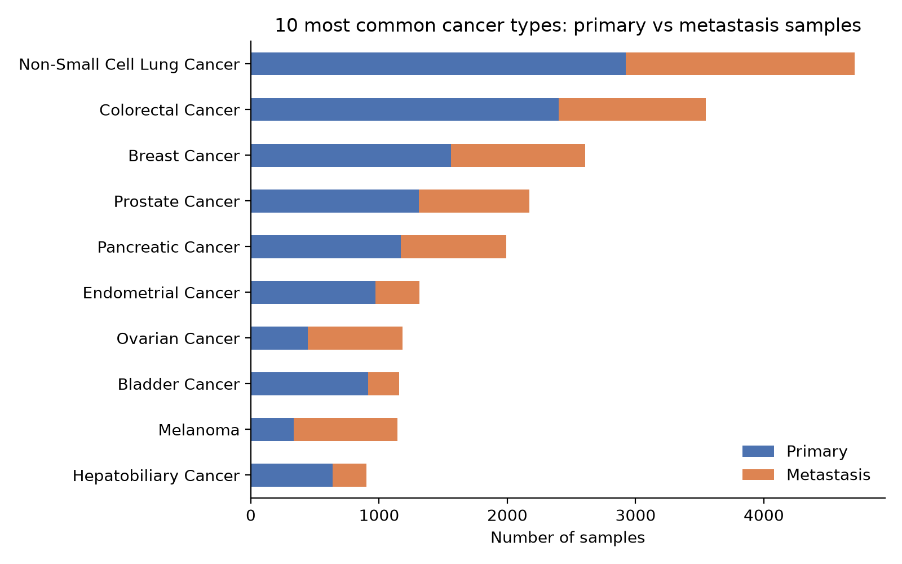
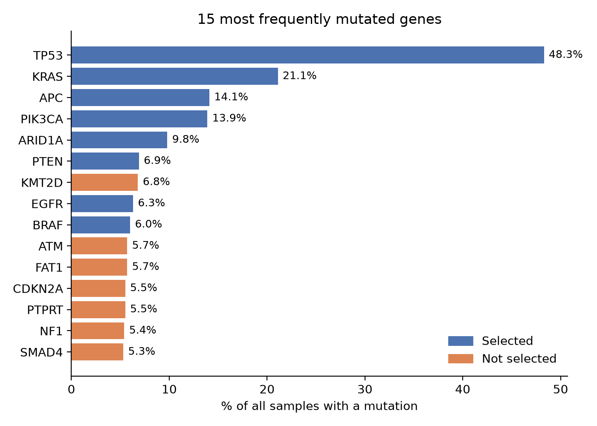
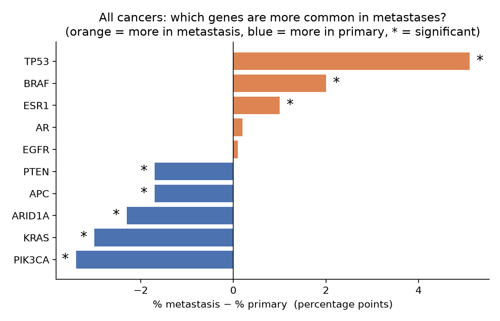
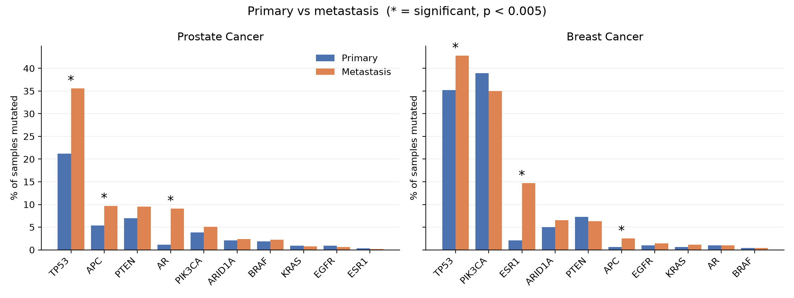

# Primary Tumour vs Metastasis: Gene Mutations in MSK-MET

**Author:** Marina Gorikova · November 2026
**Tools:** Python (pandas, numpy, scipy, matplotlib), PyCharm

## Question
Which gene mutations are more common after cancer spreads (metastasis) than in the original (primary) tumour?

## Data
- **Study:** MSK-MET – *MSK MetTropism (MSK, Cell 2021)*, cBioPortal study ID `msk_met_2021`
- **Paper:** Nguyen B, et al. *Genomic characterization of metastatic patterns from prospective clinical sequencing of 25,000 patients.* Cell 2022;185(3):563–575. https://pmc.ncbi.nlm.nih.gov/articles/PMC9147702/
- **Size:** 25,775 patients with one tumour sample each (15,632 primary, 10,143 metastasis), sequenced with the MSK-IMPACT gene panel
- **Tables used:**
  - `data_clinical_sample.txt`: whether each sample is primary or metastasis, and its cancer type
  - `data_mutations.txt`: which genes are mutated in each sample

The data is **not included** in this repository (see *How to run*).



## Method
1. Kept only mutations that change the protein (225,169 mutations).
2. Selected 10 genes: the most frequently mutated cancer genes (TP53, KRAS, APC, PIK3CA, ARID1A, PTEN, EGFR, BRAF) plus AR and ESR1, which were reported by Nguyen et al. (2022).
3. Marked each sample as mutated or not, and compared the percentage in primary tumours and metastases.
4. Tested each difference with Fisher's exact test (significant if p < 0.005, Bonferroni correction for 10 genes).
5. Repeated the comparison within prostate and breast cancer.



## Results

### All cancers together
TP53 was more common in metastases (51.4% vs 46.3%). Several genes looked more common in primary tumours, but this partly reflects which cancer types are sampled more often as metastases. AR showed no difference (2.6% vs 2.8%).



### Within prostate and breast cancer
| Cancer | Gene | Primary | Metastasis |
|---|---|---|---|
| Prostate | AR | 1.1% | 9.1% |
| Prostate | TP53 | 21.2% | 35.6% |
| Prostate | APC | 5.4% | 9.7% |
| Breast | ESR1 | 2.1% | 14.7% |
| Breast | TP53 | 35.2% | 42.8% |
| Breast | APC | 0.6% | 2.5% |

All differences in the table are significant (p < 0.005).



## Conclusion
- **TP53** mutations were more common in metastases across all cancers and within prostate and breast cancer.
- The largest differences were **AR** in prostate cancer and **ESR1** in breast cancer. This matches Nguyen et al. (2022) and is most likely caused by hormone therapy, which selects for these mutations.
- AR showed no difference across all cancers combined but was the strongest result within prostate cancer, so comparisons should be made within single cancer types.

## Limitations
- Primary and metastatic samples come from different patients, not the same tumour over time.
- Treatment may cause some of the differences.
- Only mutations in genes on the MSK-IMPACT panel were analysed (no copy number or fusions).
- Only two cancer types were analysed in detail.

## How to run
1. Download the study from cBioPortal: **Data Sets** → search *MetTropism* → download `msk_met_2021.tar.gz`.
2. Put `msk_met_2021.tar.gz` in this folder, next to the notebook.
3. Install the packages: `pip install -r requirements.txt`
4. Open `msk_met.ipynb` and run all cells. The first cell unpacks the data, and the charts are saved to `figures/`.

## Files
```
msk_met.ipynb        the full analysis
README.md            this report
requirements.txt     Python packages needed
.gitignore           excludes the data from the repository
figures/             all charts
```

## Data licence
MSK-MET data is available from cBioPortal under the Creative Commons BY-NC-ND 4.0 licence.
